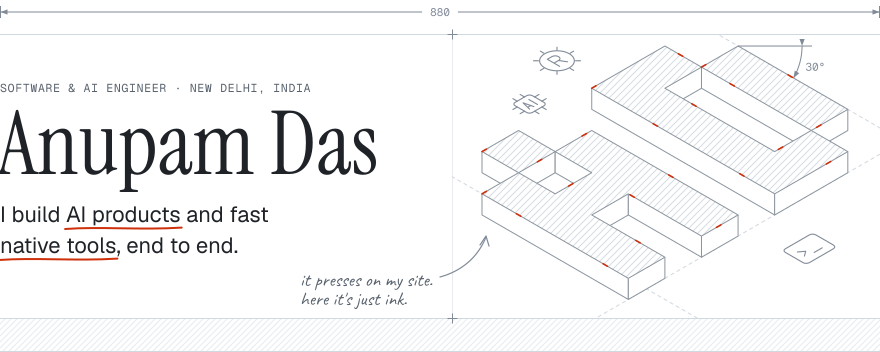
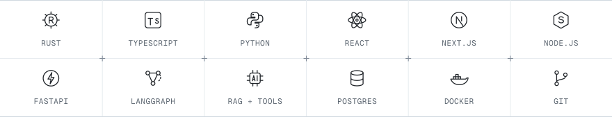
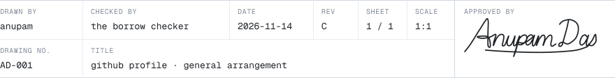

<!--
  Drawing AD-001, rev C. The pictures in assets/ are built from build/content.mjs:
  change a figure there and in the text below, run `node build/build.mjs`, commit both.
-->

<a href="https://www.anupamdas.me">
  <picture>
    <source media="(prefers-color-scheme: dark)" srcset="assets/hero-dark.svg">
    
  </picture>
</a>

I'm Anupam, a software and AI engineer in New Delhi and a final-year B.Tech student at BPIT. I like owning a product end to end: the interface, the backend, the release pipeline and the numbers that show it works.

<code>now</code>&nbsp; AI/LLM Intern at [PlanCover](https://www.plancover.com/), building a production AI insurance assistant: retrieval over policy documents plus authenticated tool-calling across policies, claims, benefits and employees, with role-based access, streaming and citations. 
<code>before</code>&nbsp; AI full-stack developer at Dasgupta Maiti & Associates (2026) and product engineering intern at Syuniqe (2025). 
<code>open&nbsp;to</code>&nbsp; full-time roles, internships and freelance work. **[Resume (PDF)](https://www.anupamdas.me/Anupam-Das-Resume.pdf)** · [book a call](https://cal.com/itsmrad) · [itsmrad@gmail.com](mailto:itsmrad@gmail.com)

<a href="https://www.anupamdas.me/#work"><picture><source media="(prefers-color-scheme: dark)" srcset="assets/head-work-dark.svg"></picture></a>

<a href="https://codenaya.tech">
  <picture>
    <source media="(prefers-color-scheme: dark)" srcset="assets/codenaya-dark.svg">
    
  </picture>
</a>

**[Codenaya](https://codenaya.tech)**: describe the app you want in plain English; Codenaya writes it, runs it in your browser and hands you the code. A browser IDE with a coding agent built in: live preview and a terminal in a cloud sandbox, export to a new GitHub repo or a ZIP, and 15 hosted models or any model through your own API key. My own product, started in February 2026. 
[codenaya.tech](https://codenaya.tech) · [source](https://github.com/itsmrad/codenaya) · [docs](https://www.codenaya.tech/docs)

Three engineering decisions

- **Agent runs that outlive a deploy.** A run takes minutes and many model and tool calls, so each one is a durable Inngest AgentKit function: database writes and side effects run as steps, and a crash or a deploy resumes the run instead of losing it. Runs can be cancelled from another request.
- **Keys that never touch run history.** The runtime stores every step's return value, so keys are resolved in the function body, outside every step, on each replay. Stored keys are sealed with AES-256-GCM envelope encryption, and a rejected key never falls back to the platform key.
- **A build check before it says done.** A finish gate counts writes after the last passing check. If the agent tries to stop with unchecked changes, the run sends it back once to run `tsc` and `vite build` in the sandbox; an end-to-end spec holds the gate in place.

Built with Next.js 16, React 19, TypeScript, Tailwind CSS 4, CodeMirror 6, Convex, Clerk, Inngest AgentKit, E2B, Sentry, Playwright and Vitest.

<a href="https://github.com/itsmrad/xflow">
  <picture>
    <source media="(prefers-color-scheme: dark)" srcset="assets/xflow-dark.svg">
    
  </picture>
</a>

**[xflow](https://xflowcli.vercel.app)**: hold a key and talk; xflow types what you said into whatever app you are using, on macOS and Linux. A small Rust daemon with a CLI and a terminal UI: ten cloud speech providers plus local whisper.cpp behind one interface, pasted at the cursor, the clipboard it replaced restored, secure fields refused. No Electron, no WebView, no telemetry. 
[website](https://xflowcli.vercel.app) · [source](https://github.com/itsmrad/xflow) · [releases](https://github.com/itsmrad/xflow/releases) · [benchmarks](https://github.com/itsmrad/xflow/blob/main/docs/benchmarks/scoreboard-macos.json)

Measured 2026-10-29 at commit 6ebd451 on an Apple M2 with 8 GB, macOS 26.7.1. Memory is phys_footprint: idle is the median of 1 Hz samples over 300 s. Stop to text: 30 live Groq dictations of one 7.0 s clip, from the stop request to text in a file, real paste excluded.

Three engineering decisions

- **Twenty-minute dictations without the wait.** The daemon drains the capture buffer every second and transcribes 30 to 60 second segments, cut at the quietest 250 ms, while recording continues. Memory stays bounded, and stopping only waits for the last segment.
- **Paste into whatever has focus, safely.** On macOS it reads the frontmost app, window and focused Accessibility element, pastes with the key that types "v" in the current layout, and refuses secure fields. When the target is unknown or has changed, nothing is typed: the text is copied and kept for recovery.
- **Silence is not speech.** Before upload, 20 ms frames must hold at least 80 ms above a configurable floor, and known silence hallucinations are discarded, so a silent press ends with "Didn't catch anything" instead of invented text.

Shipped with CI-gated tagged releases, a checksum-verifying installer, .deb and .rpm packages for amd64 and arm64, an Arch PKGBUILD, a Nix flake, a signed macOS package and a Homebrew tap.

<a href="https://www.anupamdas.me/#stack"><picture><source media="(prefers-color-scheme: dark)" srcset="assets/head-stack-dark.svg"></picture></a>

<picture>
  <source media="(prefers-color-scheme: dark)" srcset="assets/stack-dark.svg">
  
</picture>

Rust, TypeScript, Python, React, Next.js, Node.js, FastAPI, LangGraph, RAG and tool calling, PostgreSQL, Docker, Git. Also JavaScript, C/C++, SQL, Express, JWT, OAuth 2.0, Tailwind CSS, shadcn/ui, MongoDB, Convex, Pinecone, LangChain, OpenRouter, Vercel AI SDK, Langfuse, CI/CD, Sentry, Postman and Figma.

<a href="https://www.anupamdas.me/#work"><picture><source media="(prefers-color-scheme: dark)" srcset="assets/head-building-dark.svg"></picture></a>

- [`larpcc`](https://github.com/itsmrad/larpcc): a Rust CLI that keeps separate Claude Code and Codex profile directories from colliding.
- [`vidura`](https://github.com/itsmrad/vidura): the foundation for one persistent assistant across web, desktop and mobile.

<a href="https://www.anupamdas.me/#contact"><picture><source media="(prefers-color-scheme: dark)" srcset="assets/head-contact-dark.svg"></picture></a>

  <a href="https://www.anupamdas.me/Anupam-Das-Resume.pdf"><picture><source media="(prefers-color-scheme: dark)" srcset="assets/button-resume-dark.svg"></picture></a>
  <a href="https://cal.com/itsmrad"><picture><source media="(prefers-color-scheme: dark)" srcset="assets/button-call-dark.svg"></picture></a>
  <a href="mailto:itsmrad@gmail.com"><picture><source media="(prefers-color-scheme: dark)" srcset="assets/button-email-dark.svg"></picture></a>

[itsmrad@gmail.com](mailto:itsmrad@gmail.com) · [anupamdas.me](https://www.anupamdas.me) · [X @AnupamIO](https://x.com/AnupamIO) · [LinkedIn](https://www.linkedin.com/in/itsmrad)

<picture>
  <source media="(prefers-color-scheme: dark)" srcset="assets/title-block-dark.svg">
  
</picture>
